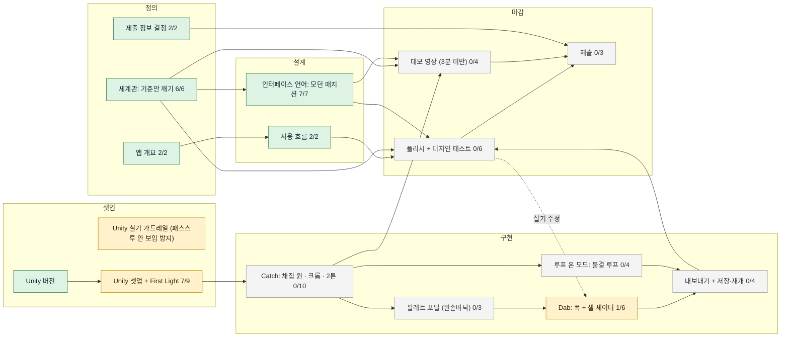

# Gaze · Catch · Dab 보드

작업대 앱 id: mood-picker

> 작업대 `my-mr-studio` 의 보드를 내보낸 **읽기 전용** 사본이에요. 갱신: 2026-11-04 00:14 KST · 과업 6/16 완료
> 고칠 때는 작업대에서 (`npm run studio -- … --app mood-picker`), 그다음 `scripts/sync-docs.sh` → 커밋·푸시.

범례: ✅ 완료 · 🔶 진행 중 · 👀 확인 필요 · ⬜ 대기 · ⛔ 막힘 · ▶ 과업 안에서 지금 차례

## 지금 할 일

| 누가 | 하위 과업 | 과업 | 상태 |
| --- | --- | --- | --- |
| 사람 | 실기 First Light: 방 + 가상 + 카메라 텍스처 + 손이 한 화면에 | [Unity 셋업 + First Light](nodes/setup.md) | ⬜ 대기 |

## 흐름

## 1. 정의

_11-03 · 무엇을, 어떤 조건으로 만들지 (HANDOFF.md 기준)_

### ✅ [앱 개요](nodes/brief.md) · 2/2

이 앱만의 조건을 한 장으로

- [x] **개요 표 초안 채우기** · 에이전트 · 작성
   대화와 메모에서 채운다. 공통 조건(플랫폼 조건)은 다시 적지 않는다
- [x] **개요 확정** · 사람 · 결정

### ✅ [제출 정보 결정](nodes/submit-meta.md) · 2/2

이름·트랙·부문을 정한다 (HANDOFF §8-1, 3, 4)

- [x] **부문 근거: 2026-09-24 이전 코드·빌드가 있는지** · 에이전트 · 분석
   관련 폴더와 git 날짜를 찾아 메모. New Experience vs Adapted 판단 근거만 정리
- [x] **이름 · 트랙 · 부문 결정** · 사람 · 결정
   Gaze · Catch · Dab vs gaze-catch-get / Productivity vs Entertainment / New vs Adapted

### ✅ [세계관: 기준안 깨기](nodes/world.md) · 6/6

컨셉을 하나의 세계로. 평균 세계관을 지도로 만들고 사람이 깰 지점을 고른다

- [x] **측정용 기준안 세계관** · 에이전트 · 작성
   가장 뻔하게. 창의성을 넣지 않는다
- [x] **관습·기능·예측 지도 표** · 에이전트 · 분석
   요소마다 관습, 하는 일, 예측(상·중·하)
- [x] **바깥 씨앗 던지기** · 사람 · 수집
   다듬지 않은 메모, 버린 초안, 안 어울리는 레퍼런스 두 개, 무관한 단어 — 모델 밖 재료
- [x] **깰 지점 2~3개 고르기** · 사람 · 결정
   에이전트는 추천만
- [x] **지점별 대안 5개** · 에이전트 · 작성
   기능은 지키고 형식만 깬다. 시간·공간·주체·감각·자유 축. 기능 판정은 _ME/experience-grammar.md 북극성
- [x] **조합 고르기** · 사람 · 결정

## 2. 설계

_손 흐름, 첫 5분, 중단·재개를 정한다_

### ✅ [사용 흐름](nodes/usage-flow.md) · 2/2

전철 채집 → 집에서 바르기까지, 그리고 중단·재개

- [x] **흐름 표 초안** · 에이전트 · 작성
   단계마다 사용자 목표, 시스템 반응, 실패하면. 제스처 이름은 공통 핸드 패턴
- [x] **흐름 확정** · 사람 · 결정

### ✅ [인터페이스 언어: 모던 매지션](nodes/interface.md) · 7/7

세계관 v1을 화면·소리·폰트 규칙으로. 실측 HUD와 재료 타일의 첫 시안

- [x] **팔레트 다시 고르기 (CRT 팔레트 폐기 여부)** · 사람 · 결정
   에이전트가 레퍼런스(r4·r7·r9·r10)에서 뽑은 후보 2~3안을 먼저 메모로
- [x] **질감: 2톤 셀 유지 / 회화 질감 섞기** · 사람 · 결정
- [x] **폰트 후보: 도면 레터링 · 에디토리얼 세리프 · 한글** · 에이전트 · 분석
   _ME/graphic-resources.md 출처 먼저. 라이선스(앱 임베드), TMP 한글 아틀라스 크기, 헤드셋 가독성
- [x] **실측 HUD 시안: 측량 원, 응시 카운터, 방위, 표제란, 모드 토글** · 에이전트 · 생성
   2D 시안. 찰칵 / 루프 온 두 모드의 HUD 차이 (루프 온은 타임코드가 돈다). 토글 위치는 한 손·무릎 위 기준. 선 굵기·글자 크기 하한 표시
- [x] **재료 타일 + 표제란 라벨 시안** · 에이전트 · 생성
- [x] **소리 방향표 (동화)** · 에이전트 · 작성
   이벤트별: 응시 누적, 담기, 포탈 열기, 타일 꺼내기, 푝
- [x] **인터페이스 언어 확정** · 사람 · 결정

## 3. 셋업

_11-03~04 · Quest에서 패스스루 + 손 + 카메라 텍스처 First Light_

### 🔶 [Unity 실기 가드레일 (패스스루 안 보임 방지)](nodes/unity-guardrails.md) · 공통

### ✅ [Unity 버전](nodes/unity-version.md) · 공통

### 🔶 [Unity 셋업 + First Light](nodes/setup.md) · 7/9

Quest 3에서 패스스루, 손, 카메라 텍스처가 한 화면에 보인다

- [x] **가드레일 읽고 이번 셋업 체크리스트 뽑기** · 에이전트 · 분석
   show unity-guardrails --app shared. 정해진 Unity 버전 기준으로 §1~§4를 체크리스트로 setup 메모에 덧붙인다
- [x] **Unity 프로젝트 생성 + Meta SDK·MRUK 임포트 + XR 플러그인** · 사람 · 구현
   unity/mood-picker/ 는 이미 git 레포(reality404studio/meta-mr-picker)라 비어 있지 않음 → Hub에서 URP 프로젝트를 unity/_new/mood-picker 에 만들고, 에이전트가 Assets·Packages·ProjectSettings 를 unity/mood-picker/ 로 옮긴다. Android 전환, ASTC. XR 플러그인은 OpenXR 하나 (가드레일 §2). Project Setup Tool Fix All
- [x] **설정 파일 점검** · 에이전트 · 검증
   가드레일 §1~§3 의 [M] 항목: ProjectSettings, packages-lock, XR 로더 asset, AndroidManifest 권한. 결과를 setup 메모에
- [x] **씬: Camera Rig + Passthrough + 손 추적 + 카메라 접근 켜기** · 사람 · 구현
   가드레일 §3. OVRManager 의 Passthrough Support / Enable Passthrough / Passthrough Camera Access, Skybox None
- [x] **빌드 게이트 + 빌드 ID (unity/shared/BuildGate/)** · 에이전트 · 구현
   IPreprocessBuildWithReport. 실패: XR 로더 1개, HEADSET_CAMERA 권한, Skybox None, 카메라 1대, 외곽선 _Cull 1, 금지 API(Shader.Find·ReadPixels·WebCamTexture·OVRInput). 경고만: Development Build 꺼짐. 빌드 ID(git 짧은 해시+시각)를 박고 앱 첫 로그에 [MP] build=… 출력
- [x] **사전 점검 스크립트 (에이전트용)** · 에이전트 · 구현
   게이트와 같은 파일 검사 + Roslyn 컴파일 체크. 사람에게 빌드를 부탁하기 전에 매번 돌리고 결과를 note 로
- [x] **First Light 스크립트: 정면 Unlit 큐브 + 카메라 텍스처 쿼드 + 손끝 점** · 에이전트 · 구현
   가드레일 §4·§5. SerializeField 머티리얼, PassthroughCameraAccess 1280×960 요청 후 CurrentResolution 로그, 권한 요청은 한 곳
- [ ] ▶ **실기 First Light: 방 + 가상 + 카메라 텍스처 + 손이 한 화면에** · 사람 · 검증
   Development Build 설치. 에이전트가 logcat·screencap 으로 같이 확인 (가드레일 §6) · 증거: 빌드 ID가 찍힌 logcat 발췌 + 스크린샷을 첨부해야 done
- [ ] **전철 실기: Travel Mode 에서 패스스루 · 손 · 카메라 · 공중에 둔 물체** · 사람 · 검증
   First Light 빌드를 전철에 들고 가서. 설정 > 실험 기능 > Travel Mode (기차 지원, v71+). 공중에 띄운 물체가 차량 가감속에 미끄러지는지, 손 추적이 흔들림에 버티는지, PCA 가 도는지. 컨셉 전체가 여기에 걸려 있어 최대한 일찍

## 4. 구현

_11-05~14 · Catch → Loop → 포탈 → Dab → 내보내기. MVP = Catch + 포탈 + Dab_

### ⬜ [Catch: 채집 원 · 크롭 · 2톤](nodes/catch.md) · 0/10

11-05~07 · 머리 레이 + 핀치 간격으로 영역을 담는다. 찰칵(정지 텍스처, 무늬 보존 2톤) 모드가 MVP

기다림: Unity 셋업 + First Light

- [ ] ▶ **테스트 영상 촬영: 윤슬 · 나뭇잎 · 바닥 타일 (+ 밤 불빛)** · 사람 · 수집
   폰으로. 과목당 고정 10~15초 + 손에 든 10초, 노출·초점 잠금. 원본은 my-vr-colorpicker/footage/ (git 밖), 메모만 여기에
- [ ] **테스트 영상으로 CelExtract·Loop 오프라인 검증 (Mac)** · 에이전트 · 분석
   실기 전에 2톤 추출·빛 방향·루프 이음매를 영상 크롭으로 미리 맞춘다. 결과 이미지를 catch 파일 칸에
- [ ] **머리 방향 레이로 채집 중심** · 에이전트 · 구현
   Quest 3엔 눈 추적 없음. 응시를 클릭 대용으로 쓰지 않는다 (HANDOFF §4-1)
- [ ] **양손 핀치 → 정사각형 채집 영역 크기, 기록 시간이 지나면 자동으로 담김** · 에이전트 · 구현
   DECIDED 2026-11-03. 원 대신 정사각형(타일과 같은 모양). 손 떼고도 영역 유지되는지, 자동 담기 타이머는 HUD 타임코드로 보임
- [ ] **월드 → 카메라 이미지 투영, 영역만 크롭** · 에이전트 · 구현
   PassthroughCameraAccess.WorldToViewportPoint, CurrentResolution 기준. AsyncGPUReadback. 원본 전체 프레임 저장 금지
- [ ] **CelExtract: 2~3톤 + 빛 방향 근사** · 에이전트 · 구현
   k-means, 디라이팅 없음. 밝은 쪽 방향 = lightDir
- [ ] **모드 토글: 한 손 핀치 1회 = 찰칵 / 루프 온 전환** · 에이전트 · 구현
   양손 핀치(크기)와 구분: 한 손만 핀치 = 토글. 손바닥이 얼굴 쪽일 땐 무시(Quest 시스템 메뉴)
- [ ] **찰칵: 무늬 보존 2톤 + 이음매 없는 타일** · 에이전트 · 구현
   옷감·벽·타일처럼 무늬가 재료인 것. 크롭을 픽셀마다 2톤으로(톤만 뽑으면 무늬가 사라짐) + 가장자리 이음매 제거해서 트라이플래너로 반복해도 티 안 나게. 테스트 영상의 타일로 먼저 비교
- [ ] **PaintStore: 물감 JSON 저장·로드** · 에이전트 · 구현
   HANDOFF §5 데이터 구조 + mode: snap \| loop. snap 은 loop 없음. Application.persistentDataPath
- [ ] **실기: 실내·창밖에서 담아 보기** · 사람 · 검증
   흔들려도 원이 따라오는지, 톤이 그럴듯한지. MQDH 캐스팅으로 같이 본다 · 증거: 빌드 ID가 찍힌 logcat 발췌 + 스크린샷을 첨부해야 done

### ⬜ [루프 온 모드: 물결 루프](nodes/loop.md) · 0/4

11-08~09 · 토글을 켜면 움직이는 재질을 짧은 반복 루프로 담는다. 응시 시간 = 진하기·루프 길이 (MVP 다음 순위)

기다림: Catch: 채집 원 · 크롭 · 2톤

- [ ] ▶ **약 2초, 10~15fps 크롭 프레임 수집** · 에이전트 · 구현
   MaxFramerate 낮춰 요청, AsyncGPUReadback, 메모리 상한
- [ ] **끝-시작 크로스페이드 + 플립북** · 에이전트 · 구현
   텍스처 배열 또는 시트. 셀 셰이더 플립북 입력 형식과 맞춘다
- [ ] **응시 시간 → 진하기 · 루프 길이** · 에이전트 · 구현
   3초 옅게, 20초 깊게. 수치는 실기에서 조정
- [ ] **실기: 물결 루프가 이음매 없이 도는지** · 사람 · 검증
   증거: 빌드 ID가 찍힌 logcat 발췌 + 스크린샷을 첨부해야 done

### ⬜ [팔레트 포탈 (왼손바닥)](nodes/portal.md) · 0/3

11-10~11 · 왼손바닥 포탈에 손가락을 넣었다 빼면 손끝에 물감이 묻는다

기다림: Catch: 채집 원 · 크롭 · 2톤

- [ ] ▶ **왼손바닥 위로 뒤집기 감지 → 포탈 열기** · 에이전트 · 구현
   손바닥 위 5~10cm 에 띄움. 공통 hand-patterns 의 "손바닥 위로"(얼굴 향함)와 다르다: 여기선 하늘을 향함
- [ ] **오른손가락 넣었다 빼기 → 손끝에 물감** · 에이전트 · 구현
   포탈 열린 동안 핀치 금지 (시스템 제스처 충돌)
- [ ] **실기: 두 손이 가까워도 추적이 안 흔들리고 시스템 메뉴가 안 뜨는지** · 사람 · 검증
   증거: 빌드 ID가 찍힌 logcat 발췌 + 스크린샷을 첨부해야 done

### 🔶 [Dab: 푝 + 셀 셰이더](nodes/dab.md) · 1/6

11-10~12 · 오브제를 손끝으로 찌르면 닿은 지점부터 셀 재질이 번진다 (여기까지 MVP)

기다림: 팔레트 포탈 (왼손바닥)

- [x] **결정: 집 무대(CRT 세계 유지?), 오브제 목록, 손 판단 방식** · 사람 · 결정
   HANDOFF §8-2, 5, 6. 에이전트는 선택지만 메모로 정리하고 멈춘다
- [ ] ▶ **CelShader: 트라이플래너 + 2톤 램프 + lightDir + 남색 외곽선 + 플립북** · 에이전트 · 구현
   가드레일 §5 (알파 쓰기, ColorMask RGB 금지, 외곽선 Render Face Back). 광원 없이 동작
- [ ] **DabPaint: 접촉점 → 페인트 마스크 번짐** · 에이전트 · 구현
   거리 + 노이즈. 오브제별 렌더 텍스처는 작게 (72fps)
- [ ] **HandJudge 휴리스틱: 톡 / 꾹** · 에이전트 · 구현
   접근 속도, 관통 깊이, 손가락 굽힘. 휴리스틱만 (ML 분류기 안 함, 2026-11-03 결정)
- [ ] **오브제: 페트병 하나 먼저 (나머지는 시간 남으면)** · 에이전트 · 생성
   폴리 예산 지키기. 의자·머그는 MVP 이후
- [ ] **실기: 페트병에 "푝" → 셀 물결이 흐르고 72fps** · 사람 · 검증
   증거: 빌드 ID가 찍힌 logcat 발췌 + 스크린샷을 첨부해야 done

### ⬜ [내보내기 + 저장·재개](nodes/export.md) · 0/4

11-13~14 · 만든 걸 게임 에셋으로 꺼내고, 껐다 켜도 이어진다

기다림: Dab: 푝 + 셀 셰이더, 루프 온 모드: 물결 루프

- [ ] ▶ **GLB (메시 + 정지 텍스처), glTFast** · 에이전트 · 구현
- [ ] **루프 스프라이트 시트 PNG + 셰이더 파라미터 JSON** · 에이전트 · 구현
   glTF엔 애니메이션 텍스처 표준이 없어 따로 낸다
- [ ] **저장·재개 + 빠른 시작** · 에이전트 · 구현
   버스 한 정거장 테스트: 벗었다 다시 써도 그 자리에서 이어짐
- [ ] **실기: 내보낸 파일을 adb pull 해서 PC에서 열어 보기** · 사람 · 검증
   증거: 빌드 ID가 찍힌 logcat 발췌 + 스크린샷을 첨부해야 done

## 5. 마감

_11-15~18 · 폴리시, 디자인 테스트, 데모 영상, 제출_

### ⬜ [폴리시 + 디자인 테스트](nodes/polish.md) · 0/6

11-15~17 · 첫 5분을 다듬고 대회 디자인 가이드라인 테스트를 통과한다

기다림: 내보내기 + 저장·재개

- [ ] ▶ **첫 실행용 기본 물감 번들** · 에이전트 · 구현
   물감 0개로 시작해도 바로 푝 하도록 샘플 물감 몇 개 + '내 방에서 담아 보기' 안내. 실제 한강 물감은 demo-shoot-commute 에서 담은 걸 넣고, 그 전엔 임시 물감
- [ ] **첫 5분 온보딩** · 에이전트 · 구현
   Best First Five Minutes. 설명 없이 알아채게. usage-flow 표 기준
- [ ] **사운드 + 셀 외곽선 정리** · 에이전트 · 구현
- [ ] **(선택) 눈 추적 층** · 에이전트 · 구현
   감지되면 켜고, 없으면 머리 레이. 시간 남을 때만
- [ ] **핸즈 온리 완주: 컨트롤러 끄고 처음부터 끝까지** · 사람 · 검증
   하드 요구사항. 디버그용으로 켰던 컨트롤러 의존(샘플의 A/B 버튼 등)이 남았는지 · 증거: 빌드 ID가 찍힌 logcat 발췌 + 스크린샷을 첨부해야 done
- [ ] **비행기 좌석(60cm, 앉아서) · 버스 한 정거장 · 가져가 보기** · 사람 · 검증
   결과를 polish README 표에 · 증거: 빌드 ID가 찍힌 logcat 발췌 + 스크린샷을 첨부해야 done

### ⬜ [데모 영상 (3분 미만)](nodes/demo-video.md) · 0/4

첫 20초에 최고 장면. Catch 가 되면 전철 촬영부터 시작

기다림: Catch: 채집 원 · 크롭 · 2톤

- [ ] ▶ **콘티: 첫 20초 + 3분 구성** · 에이전트 · 작성
   HANDOFF §4 콘티 초안에서. 연출 선택지는 서로 다른 축 2~5개로 내고 멈춘다
- [ ] **전철 실제 채집 장면 (여러 날)** · 사람 · 수집
   11월 중순 일몰 17:20 전후, 지상 구간 한강 철교. 타인 얼굴 안 나오게
- [ ] **집 장면: 포탈 → 푝 → 물결** · 사람 · 수집
- [ ] **편집 + 공개 업로드** · 사람 · 생성
   3분 미만

### ⬜ [제출](nodes/submit.md) · 0/3

11-18(수) 저녁 KST 제출 완료 (마감 11-19 05:00 KST)

기다림: 폴리시 + 디자인 테스트, 데모 영상 (3분 미만)

- [ ] ▶ **제출 폼 초안: 140자 태그라인, 500단어 설명, 손 인터랙션 설명** · 에이전트 · 작성
   submit README 에
- [ ] **APK를 "Competition" 릴리스 채널에 업로드, 초대 URL 확인** · 사람 · 구현
- [ ] **Devpost 제출 + 확인** · 사람 · 검증

---

- 결정: [정한 것](../docs/DECIDED.md) · [안 하기로 한 것](../docs/REJECTED.md)
- 정본 컨셉: [HANDOFF](../docs/HANDOFF.md) · Unity 함정: [가드레일](../docs/UNITY_GUARDRAILS.md)
